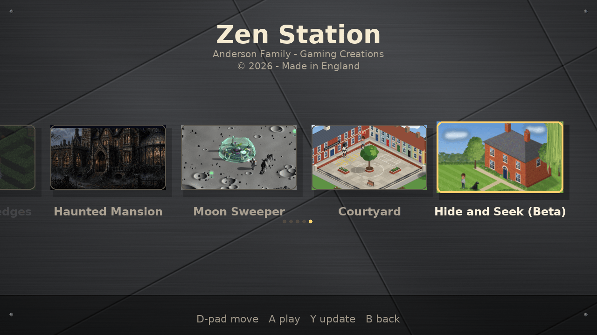

# Zen Station



A controller-driven home screen for a Raspberry Pi 5 plugged into the telly.
Pick Daleks in Hedges, Haunted Mansion, Moon Sweeper, Courtyard or Hide and Seek (Beta), update them
from GitHub, or open Kodi for TV.

British English on screen. Native draw size is 1280×720, full-screen scaled on
the Pi.

## What you need

- Raspberry Pi 5 (4 GB is fine) with the kit’s microSD card
- Raspberry Pi OS **64-bit Bookworm** desktop (already on the kit card — no
  fresh card required)
- HDMI to the TV, keyboard for the first setup, wired Xbox pad (PlayStation /
  Bluetooth pad later)
- Wi-Fi

## First-time setup

1. Boot the Pi and finish the welcome wizard (country **United Kingdom**,
   Wi-Fi, user account).
2. Open **Terminal** and run:

```bash
git clone https://github.com/brixham99/Zen-Station.git
cd Zen-Station
./install.sh
```

(`Zen-Station` will be on GitHub after the first commit; until then you can copy
this folder onto the Pi with a USB stick and run `./install.sh` from there.)

3. Reboot. After the desktop loads, **Zen Station** should start on its own.

To start it by hand later:

```bash
zen-station
# or windowed on a monitor while testing:
zen-station --windowed
```

Optional TV apps:

```bash
sudo apt install kodi
```

The home screen’s **TV** tile launches Kodi when it is installed; otherwise the
tile is greyed out.

## Kiosk mode (no desktop)

To boot straight into Zen Station without loading the desktop:

```bash
cd ~/Zen-Station && git pull && ./install.sh --kiosk
sudo reboot
```

The Pi logs in on the console and starts Zen Station in `cage`, a tiny
full-screen display server. Wi-Fi, updates, sound, games and Kodi all work as
before. Hold **Q** on the launcher to exit to a text console, where
`zen-station-tv` starts it again and `zen-desktop` opens the normal desktop.

To go back to the desktop version: `./install.sh --desktop` then reboot.

## Controls

| Action | Xbox | PlayStation | Keyboard |
|--------|------|-------------|----------|
| Move   | D-pad / left stick | D-pad / left stick | Arrow keys |
| Play / confirm | A | Cross | Enter |
| Update selected game | Y | Triangle | U |
| Back / cancel | B | Circle | Esc |

Hot-plug is supported — connect the pad before or after starting.

## Updates

On start-up (and every few minutes) the launcher runs `git fetch` on each game
repo and on itself. Tiles show an **Update available** badge when upstream has
moved on. Press **Y / Triangle / U** to `git pull --ff-only` that game (and
`pip install -r requirements.txt` if requirements changed). Offline checks fail
quietly with **Offline**.

## Adding another game

Edit `games.json` — one object per game:

```json
{
  "id": "my-game",
  "name": "My Game",
  "repo": "https://github.com/brixham99/My-Game.git",
  "branch": "main",
  "entry": "game.py",
  "folder": "My-Game",
  "thumbnail": "assets/thumbnails/my-game.png"
}
```

A game can also list a one-off `"setup"` step, a script in its own folder run
with the games' Python after it is cloned or updated (and checked at each
start). Hide and Seek uses `["zenbuild.py", "--background"]` to build its room
images in the background at low priority, so the first play doesn't wait; if
you start it before that has finished, the game shows a progress screen and
carries on from where the build has got to.

`install.sh` and the launcher both auto-clone any listed game that is not yet
under `~/games/`. If no thumbnail is set (or the file is missing), the launcher
looks for the game’s own title art, then falls back to a generated name card.
The home screen scrolls horizontally and shows page dots when there are more
than a handful of tiles.

Branch is per-game (Daleks has an `hd-1280` branch if you want that later;
default is `main`. Haunted Mansion uses `master`).

## How boot-start works

`install.sh` writes:

`~/.config/autostart/zen-station.desktop`

Raspberry Pi OS Bookworm’s desktop (labwc / wayfire) starts `.desktop` files in
that folder when you log into the graphical session. The Pi is set to auto-login
to the desktop by default on the kit image, so Zen Station appears after boot
without a display manager tweak. To stop auto-start, delete or rename that
file.

## Layout on disk

```
~/Zen-Station/          # this launcher (or wherever you cloned it)
~/games/
  Daleks-in-Hedges/
  Haunted-Mansion/
  Moon-Sweeper/
  Courtyard/
  Hide-and-Seek/        # cache/ inside holds its built room images (not in git)
```

## Controller support in the games

The launcher itself understands Xbox and PlayStation pads. Haunted Mansion and
Hide and Seek have full pad support (hold **Back / Share** for a second to quit
back to Zen Station); for the others use the keyboard in-game until they get
pad mapping.

Hide and Seek on a pad: left stick or D-pad turns and walks (tank controls),
right trigger walks forwards, **Y / Triangle** looks from the other side, **B /
Circle** goes back to the title, **A / Cross** starts.

## Caveats on the Pi 5

- Full screen uses `pygame.FULLSCREEN | pygame.SCALED` at 1280×720. On Wayland
  (labwc) a first boot may need one logout/login if the autostart entry is
  added while already logged in.
- Haunted Mansion draws at **1280×800**; the others are **1280×720**. The TV
  will letterbox or the desktop will scale — both are fine.
- Dreamlo leaderboards talk plain HTTP; fine on the Pi, awkward for any future
  browser build.
- Netflix etc. through Kodi are unofficial and unreliable on a Pi; YouTube and
  iPlayer are the realistic TV targets.

## Development / self-test

```bash
python3 -m venv .venv && . .venv/bin/activate
pip install -r requirements.txt
SDL_VIDEODRIVER=dummy SDL_AUDIODRIVER=dummy python3 -m tools.selftest
```

Screenshots from the self-test land in `/workspace/zenstation_shots/` when run on
the build machine, or `./shots/` locally.
